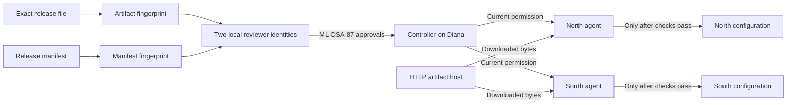
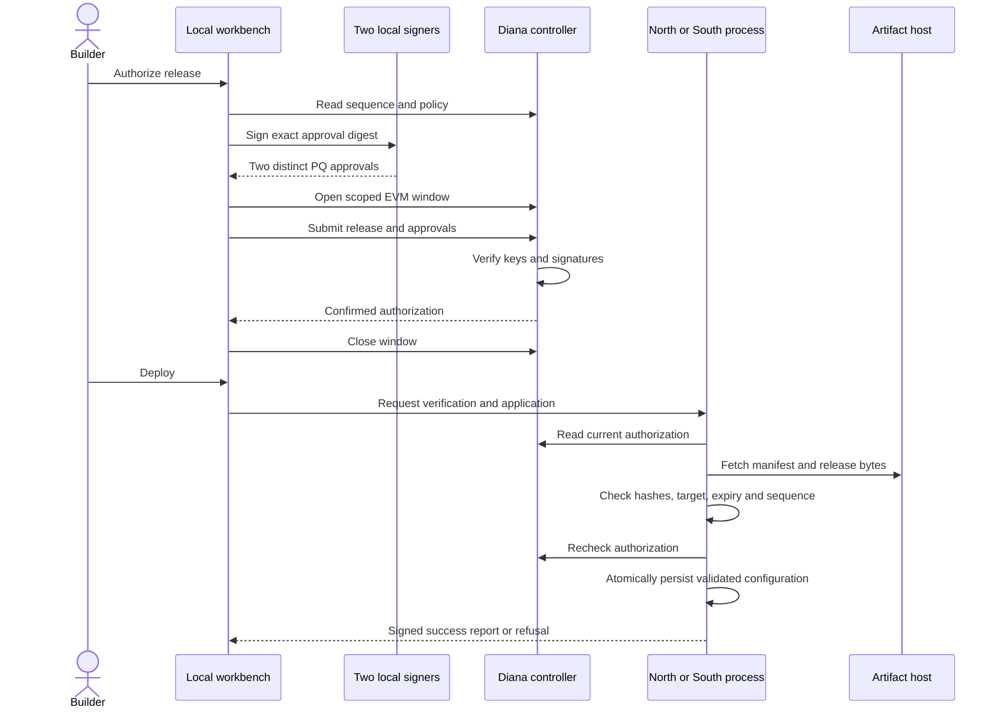

# Veylith

**The release you approved. The bytes they receive.**

**First time here?** Start with [the plain-English explanation](#plain-english-explanation), then follow [the guided demonstration](#guided-demonstration-click-by-click). Developers can jump to [run locally](#run-locally), [architecture](#architecture), or [troubleshooting](#troubleshooting).

Veylith is an exact-release authorization prototype for QoreChain's Build Before Q-Day fest. Two reviewers approve a fingerprint of an artifact and its manifest using ML-DSA-87. A Solidity controller verifies the approvals on Diana. Two independent local deployment-agent processes fetch the hosted bytes, check current chain authorization and apply only the approved configuration.

**Status:** functional testnet/local prototype; unaudited. Category: Post-Quantum dApp. The visuals explain real operations, while the application and reviewer identities are intentionally small demo fixtures.

## What works

- A live two-reviewer controller uses QoreChain `pqcVerify` and `pqcKeyStatus`, requiring registered keys with proof of possession.
- Approvals bind chain, controller, project, environment, artifact, manifest, sequence, expiry and policy epoch. Policy rotation requires the old quorum and invalidates the previous release.
- SDK hybrid native transactions open bounded EVM windows for the deployed target, then explicitly close them.
- Two separate Node processes download a bounded JSON configuration and manifest from the local HTTP artifact host, verify authorization and bytes, persist anti-replay state and apply atomically.
- An interactive React workbench shows actual local application state, agent refusals and public transaction evidence. Agent success reports use Ed25519 signatures; these are not PQ receipts or remote attestation.
- 13 Hardhat contract tests and 10 agent tests pass. The live end-to-end walkthrough passed 9 checks; see [public evidence](evidence/live-flow.json).

## What is still unfinished

QoreX browser-based arbitrary-message PQ signing; authenticated QoreSeal reviewer packets in the application; confirmation of the public hosted deployment; the event-required two-stage QCAI audit; independent review of security claims; final cover/video and project-page completion. The installed QoreSeal package is not evidence of completed app integration. Contract tests use mock precompiles locally; the live proof separately exercises real Diana precompiles.

## Public testnet deployment

Network: `qorechain-diana` (EVM chain ID 9800).

| Item | Identifier |
|---|---|
| Release controller | `0x9700232112bda62e79f20ceb862ed5e6182b9872` |
| Maintainer native address | `qor1p2nf2u4kpp2smxuuruqr959z3eeapmlkncxlkr` |
| Maintainer EVM twin | `0x0Aa69572B608550D9b9C1f0032D0A28e73D0eFF6` |
| Security-reviewer native address | `qor16ym4tg4wq837unfa3rlkwv2u29szduvjwlrnuq` |
| Deploy transaction | `0xf1afd44694f743c2e87db1efcb42fe23c7e4bf292eeaed6eea0b00bcfc5d26e0` |
| Proven release authorization | `0x7135333fce5bb89f066ecd6bd1c3af04bc6f523bb4ec766ff0d6c3ba9cccc434` |
| Proven revocation | `0xe3c6a5bdc92da3b0c20d1c0d35ec6951f850c62a18e543d63af8e9f50020e512` |

The proof ends with the release revoked. Already applied demo configurations remain applied. This is expected behavior, not rollback.

## Run locally

### Vercel public verifier

`vercel.json` builds the Vite frontend and deploys read-only `/api/state` and `/api/proof` functions. The public page queries the current Diana controller; recorded actions and test evidence are dated separately. It does not run reviewer signers or local agent processes. A failed chain read never substitutes the historical chain snapshot as live state.

Import this GitHub repository into Vercel using the Vite preset, or run `npx vercel --prod` after Vercel login. No signing environment variables are needed. `.vercelignore` excludes local runtime/signing material; public API imports have no dependency on `lib/chain.mjs` or the local signer service.

Node.js 24 and npm were used for verification. Install and run the public checks:

```sh
npm ci --ignore-scripts
npm test
npm run build
```

The application runs with:

```sh
npm run dev
```

Open `http://127.0.0.1:5173`. Without local test identities/deployment state, the UI holds deployments and reports that live setup is unavailable. The public repository contains no signing secrets.

### Testnet identities and deployment

For the original workspace, `npm run setup:testnet` reads the already generated disposable account from the neighboring research workspace, prepares a second local demo reviewer, registers both PQ keys, and deploys the controller. It intentionally refuses to overwrite a deployment if its source hash changes.

For a standalone clone, generate two disposable funded Diana identities on your own machine and place only their mnemonic fields in ignored `.local/reviewers.json` as a JSON array of two objects. Run setup after compiling with `npm run test:contracts`; the helper reuses these local identities. Never commit that file. Registration/deployment consumes test QOR only. The local demo server signs on behalf of these two identities when an action is requested; this is a demonstration convenience, not a production custody design.

The server binds to loopback, restricts write requests to same-origin JSON and denies HTTP access to local signing files. Do not expose this signer server through a public tunnel. A public demo needs an independent wallet/signing design.

With the local server running, `npm run proof:testnet` submits testnet authorization and revocation transactions and runs both agents. It overwrites the public walkthrough evidence with the new result. Do not use a pre-drill proof as the transaction required during the actual drill window.

## Architecture

`contracts/ReleaseController.sol` is the authority boundary. `lib/chain.mjs` contains SDK/QoreSign/native-window integration. `agent/core.mjs` implements verification and atomic application. `agent/worker.mjs` runs each independent agent. `server.mjs` hosts demo artifacts, manages the processes and local signer actions. `src/` is the visual workbench. `evidence/` contains public results only.

The test doubles under `contracts/test/` exist solely for Hardhat error-path testing; none is deployed to Diana. The live key-status interface decodes possession proof explicitly because the pinned EVM package's ABI has only three outputs.

## Threat model and limits

The demo assumes a classical publishing/relayer key or artifact host can be compromised while the required PQ reviewer quorum remains uncompromised. Approvals authenticate permission for bytes; they do not prove the software is safe. A compromised reviewer quorum can authorize malicious content. An agent must actually enforce the checks; another pipeline can ignore them. The controlled payload changes a JSON configuration, not a container image or arbitrary program.

Agents check fresh observed chain state and recheck before application. There remains a race between the final chain observation and the local write; this prototype does not provide atomic transactions across a blockchain and filesystem, remote attestation or a formal finality guarantee. A crashed agent may leave a lock requiring operator inspection. Revocation stops future applications observed after revocation; it cannot undo prior deployment or erase previously decrypted data.

The official Q-Day Drill is external testing. Enrollment and survival have not been established by the local proof. The disposable classical key is submitted only through the official drill form; neither mnemonic nor PQ secret belongs there.

## Credits and original work

Built with QoreChain SDK/EVM 0.14.0 and QoreSign 0.2.0, viem, React, Vite, Solidity/solc, Hardhat and ethers. Fonts are locally bundled from Fontsource: DM Sans, Playfair Display and IBM Plex Mono; their upstream font licences are included in the installed packages. QoreSeal 0.1.0 was evaluated separately; app integration remains pending.

Research inspiration: [Sthylé](https://dorahacks.io/build/23836) for artifact lineage and [ShadowPool](https://dorahacks.io/build/38991) for exact request-to-execution binding. No code from those projects was copied. Related QoreChain entries include The Record, QoreWitness, Sealed Disclosure, LatticeWard, Fenestella and Q-Day Readiness Audit. Our intended distinction is the enforced release-to-deployment workflow; worldwide novelty is not claimed.

See [AI_USAGE.md](AI_USAGE.md) for the AI-assisted workflow. Original project source is released under the [MIT licence](LICENSE).

## Plain-English explanation

Imagine approving a parcel, then discovering that its contents were replaced before delivery. The delivery address and label can remain unchanged even though the package is different.

Software has the same problem. Reviewers might approve a release, but an attacker with access to the download server can substitute a different file. A compromised publishing credential should not automatically become permission to deploy those different contents.

Veylith connects approval to delivery: **the file an agent applies must be exactly the file authorized by the reviewers, and that authorization must still be valid.**

### What QoreChain does here

QoreChain is the blockchain our prototype uses as a shared authorization record. Its post-quantum signature verification tools let the contract check ML-DSA-87 approvals. Its key registry lets the contract check that a reviewer's signing key is registered and has proof of possession. Its hybrid transactions and EVM authorization windows protect the transport used to submit actions.

QoreChain does not hold or download our software bundle. It records permission tied to its fingerprint. The deployment agents fetch the file and enforce that permission locally.

### Vocabulary without assumptions

| Term | Meaning in this project |
|---|---|
| Artifact / bundle | The exact file being delivered: a small JSON configuration in this demo. |
| Bytes | The actual contents of that file, including formatting and newline characters. |
| Hash / fingerprint | A value calculated from those bytes. A changed file should produce a different hash. We use Keccak-256. |
| Manifest | A description naming the release version, project, environment and artifact hash. Its exact encoded bytes have a hash too. |
| Reviewer | An identity authorized to approve a release. This demo uses two identities, both operated locally by the solo builder. |
| Signature | Cryptographic evidence that a signing key approved particular bytes. It is not proof that a human carefully inspected them. |
| Post-quantum | Designed to resist known attacks using future quantum computers. It is not a guarantee about every component of an application. |
| Contract / controller | A program on QoreChain that checks approvals and stores the current release permission. |
| Agent | A separate local Node process that fetches, checks and applies the configuration. It is not an AI model. |
| Environment | The intended deployment target, such as production. Approval for one target should not authorize another. |
| Sequence | A counter that advances with accepted controller actions. Agents persist the last sequence they applied to prevent reuse. |
| Policy epoch | The version of the reviewer policy. Changing authority invalidates the old release permission. |
| Revoke | Withdraw permission for future application of a release. It does not uninstall an already applied release. |
| Testnet | A development network using test funds. The application is not deployed on QoreChain mainnet. |

## The system in pictures

GitHub renders the following Mermaid diagrams. They describe the implemented boundaries; decorative gate artwork in the interface is an explanatory metaphor.





## What is real, simulated, and unfinished

| Element | Actual status |
|---|---|
| QoreChain contract | Deployed on the real Diana testnet; public identifiers are above. |
| Review signatures | Real ML-DSA-87 signatures, checked by real Diana precompiles in the live walkthrough. |
| Two reviewers | Two distinct keys, but both are controlled by the local demo operator; not two independent humans. |
| North and South | Two separate Node child processes on one computer, not two remote servers. |
| Artifact download | Actual HTTP download from the local artifact endpoint. |
| Deployment | Actual validated JSON configuration persisted to each agent's local state file. Not Kubernetes or a production binary rollout. |
| Mini applications | React views of the persisted configuration; they are not separately hosted production services. |
| Tampering | A controlled change to the artifact endpoint, triggered by the operator. No real third-party system is attacked. |
| Bronze capsule, rings and paths | SVG illustrations connected to workbench state; no physical cryptographic hardware. |
| Agent success signatures | Real Ed25519 signatures on reports, distinct from reviewer PQ signatures. They do not prove honest execution. |
| Local tests | Contract tests use explicit test precompiles; the live evidence separately tests actual Diana infrastructure. |
| Public verifier | Read-only current-chain view with separately dated recorded test evidence; it has no connected local signers or agents. |
| QoreSeal in the UI | Unfinished; installing a dependency does not mean the feature works. |
| Browser-wallet approval | Unfinished; the local demo signs using local disposable key material. |
| Security audit / official drill survival | Not established by our own passing tests. |

## Guided demonstration: click by click

### The mission in one sentence

**Deliver the exact approved app to both agents, then prove that substituted bytes and revoked permission cannot get through.**

The interface presents this as **Operation: Exact Delivery**. You operate the second reviewer and request deliveries to two agents. The signing and authorization operations use real local demo identities and a real contract on QoreChain's Diana testnet. The world, drone and storefront artwork explain those operations visually.

Quick route:

**Inspect → approve → wait for confirmation → North → South → swap package → North refuses → restore → revoke → South refuses → inspect evidence.**

```mermaid
flowchart LR
    A[Inspect exact release] --> B[Approve as reviewer 2]
    B --> C[Wait for Diana confirmation]
    C --> D[Install at North and South]
    D --> E[Swap hosted bytes]
    E --> F[North refuses mismatch]
    F --> G[Restore original bytes]
    G --> H[Revoke permission]
    H --> I[South refuses revoked release]
    I --> J[Inspect transactions and reports]
```



### 1. Open the local mission

Start `npm run dev` and keep its terminal running. Open **http://127.0.0.1:5173/** on the same computer. Press **Ctrl+Shift+R** if you are seeing an older interface.

Use localhost for the interactive mission. The Vercel version is a public verifier with signing and agent actions disabled. It reads current chain state and separately labels recorded evidence. It cannot run the local demo identities or access your local agents.

Wait for the Diana connection. A connection error means the app cannot currently verify permission, so deployment must remain held. Use **Refresh chain** after restoring connectivity. Do not repeatedly click signing buttons through a network error.

### 2. Find your controls

On desktop windows at least 960 CSS pixels wide and 600 CSS pixels high, the interface uses a compact viewport layout:

| Area | What it contains |
|---|---|
| Left | Orbit Commerce release, maintainer approval, your reviewer identity and signing action. |
| Center | Interactive 3D hangar, cargo drone, QoreChain checkpoint and destination stations. |
| Right | North and South application previews, install results and comparison controls. |
| Bottom | Four mission objectives and the corresponding action buttons. |
| Header | Evidence sheet and network status. |
| Bottom left | Mission guide replay button. |

Narrower or shorter windows retain scrolling so controls remain accessible. Long dialogs may scroll independently.

### 3. Use the chat tutorial

A nine-step chat guide opens on first visit. Use **Next**, **Back**, **Skip guide** or its close button. The guide highlights the section being explained. Reopen it using **Mission guide** at the bottom left.

**Tutorial navigation never signs, authorizes, deploys, swaps bytes or revokes permission.** It only explains. You must explicitly choose an operation to perform it. Guide completion is remembered in browser local storage; replay is always available.

### 4. Explore the 3D world

| World object / gesture | Meaning or action |
|---|---|
| Release hangar and cargo drone | The exact release file being delivered. Click the hangar/cargo to inspect it. |
| Central QoreChain checkpoint | Contract-enforced permission. Click it to open your reviewer panel. |
| North and South screens | Independent local agent destinations. Click a destination screen to request verification and delivery. |
| Drag the scene | Orbit the camera. This does not send a transaction. |
| Scroll over the scene | Zoom the camera. This does not send a transaction. |
| Mission buttons | Accessible alternatives to clicking 3D objects. |

The drone and particles illustrate the journey. A passing animation is not evidence of successful installation. Read the agent result and applied sequence. If WebGL is unavailable, use the HTML mission buttons.

### 5. Inspect the cargo

Click the hangar. The release viewer shows the bounded configuration and its manifest:

```json
{
  "release": "1.0.0",
  "banner": "The release you approved.",
  "accent": "#91d8ba"
}
```

The configuration drives the application preview. The manifest names the version, project, environment and artifact fingerprint. A fingerprint is calculated from exact bytes, including formatting. Changing the downloaded file should change its fingerprint.

The viewer is not an encrypted review packet. Close the dialog after inspecting it.

### 6. Wait for the first reviewer

The **Release maintainer** should say **Signed this exact next release**. The server prepares a genuine ML-DSA-87 signature for the next exact proposal using the first local demo identity.

That single signature is not on-chain authorization. The controller requires two distinct reviewer approvals. You operate the second identity. These are separate keys on one machine, not two independent human reviewers.

If the label remains **Preparing real first signature…**, wait or inspect the connection error. Do not assume approval exists when preparation failed.

### 7. Approve as reviewer 2

Choose any of these equivalent controls:

- **Review & approve as reviewer 2** on the left.
- **01 · Review & sign** in the mission controls.
- The checkpoint in the 3D world.

Read the signing panel before proceeding:

| Field | Expected meaning |
|---|---|
| Application | Orbit Commerce. |
| Environment | Production on Diana. |
| First reviewer | Has signed this exact proposal. |
| Sequence | The next authorization counter; its value depends on previous actions. |
| Digest / fingerprint | The exact proposal you are approving. |

Click **Approve with my local demo identity** to sign and submit. Opening the panel alone does not authorize anything. This is our local signer UI, **not a QoreX wallet extension popup**. It uses the second identity stored on the local machine.

### 8. Follow the real progress stages

The signing panel sits to the side on desktop, leaving the 3D world visible. Six physical checkpoint segments and a matching labeled track follow shared server-reported progress:

| Stage | Actual operation |
|---|---|
| Sign | The second local identity signs the exact proposal. |
| Check approvals | The app simulates the contract call using both PQ approvals. |
| Open window | A hybrid native transaction opens a bounded, target-scoped EVM window. |
| Submit | The EVM authorization transaction is sent to Diana. |
| Confirm | The app waits for the transaction receipt. |
| Confirmed | The authorization transaction succeeded; the helper also closes its EVM window. |

The contract's simulation is a preflight check. Inclusion and execution in the actual authorization transaction establish the on-chain result.

**The track counts completed stages, not elapsed time.** “4 / 6 stages complete” is not an estimate that only one-third of the wait remains. Chain confirmation can be much slower than signing, and fast stages may pass too quickly to notice.

Wait until the operation finishes. The scene/mission should show authorization and the current sequence should advance. Choose **Continue to app delivery** or close the panel when permitted.

If an operation errors, refresh chain state before retrying. A transaction may already have confirmed even if a later network read or window-close operation failed. Never infer a failed transaction solely from the UI error.

### 9. Deliver to North

Click **02 · Send to North**, North's 3D screen, or its **Download verified release / Verify & install again** button.

North independently:

1. Reads current permission from Diana.
2. Downloads the manifest and release file through HTTP.
3. Checks their exact fingerprints against approval.
4. Checks the target, expiry, policy epoch and persistent sequence.
5. Rechecks authorization before application.
6. Atomically persists the validated configuration and returns a result.

Expected result: **Verified configuration installed**, with the new applied sequence and observed block in North's preview area.

North might already look installed from an earlier rehearsal. Saved agent state survives restarts. If its previous configuration was also version 1.0.0, the banner may not change. **Use the new sequence and agent result to confirm a fresh operation.**

### 10. Deliver to South

Click **03 · Send to South**, its station or its install button. Wait for South's independent result.

South is a separate Node process with its own persistent state. North's success does not install anything at South. The delivery objective clears after the UI observes both agents applied the current authorized sequence.

Use **Compare illustrative previous layout ↔** to switch an application preview between the basic “before” design and its installed storefront presentation. This comparison is illustrative; it does not uninstall or roll back the actual configuration. Static catalog text and product artwork are visual fixtures, not additional downloaded executable payloads.

### 11. Try a counterfeit

Click **⚡ Swap the package**. This changes the bytes returned by the local artifact endpoint without changing the approved fingerprint on-chain.

Now click **02 · Send to North** again.

Expected result: **Artifact hash mismatch**. The refusal is success for this objective. North's existing configuration remains intact because the substituted bytes must not be applied.

The counterfeit objective clears from the actual refusal report, not from a red visual effect. This is a controlled attack demonstration against our own local artifact host.

### 12. Restore and test replay protection

Click **↶ Restore package**. The artifact endpoint serves the original bytes again.

Optionally request North delivery again **without authorizing a fresh sequence**.

Expected result: **Sequence already applied**. The bytes are correct, but North already used this permission. That is replay protection working, not a broken installation.

### 13. Revoke permission

Click **⏻ Revoke access**. This performs another PQ-approved controller action. Wait for confirmation; revocation advances the sequence and marks the release revoked.

Then click **03 · Send to South** again.

Expected result: **Release revoked**. The original file can remain unchanged, but permission for future application has been withdrawn.

South's existing installed storefront remains visible. **Revocation stops future application; it does not uninstall a prior deployment.** The final objective clears when the UI observes a revoked-release refusal.

### 14. Inspect the evidence

Open **Evidence** in the header. Check the network, controller, observed block, artifact and manifest fingerprints, authorization/revocation transactions and agent reports. Use **Download public evidence** to save the local workbench snapshot.

The local export is current workbench state. The Vercel export separates current chain state from the committed recorded walkthrough. Action lists are local/recorded history, not a complete chain event index.

Agent success signatures are Ed25519, distinct from reviewer ML-DSA-87 signatures. A signed report authenticates the reporting agent's statement; it is not remote attestation or proof that the agent executed honestly.

### 15. Understand the four objectives

| Objective | What clears it |
|---|---|
| Unlock the checkpoint | Observing a non-revoked, nonzero release authorization. |
| Deliver the genuine app | Observing both agents' applied sequences matching the current authorized sequence. |
| Catch the counterfeit | An observed **Artifact hash mismatch** refusal. |
| Close the route | Observing revocation together with a **Release revoked** agent refusal. |

Objectives accumulate from results observed during the current browser session. Refreshing resets that session tracking, although existing real state may satisfy an objective when observed again. Four completed objectives are an explanatory checklist, not an independent security score, a guarantee that code is safe, or an official Q-Day Drill result.

### 16. Play again without deleting history

1. Restore the original package if it is still swapped.
2. Open the reviewer panel and approve the next sequence.
3. Deliver to North and South.
4. Repeat substitution, restoration and revocation.

Do not delete the applied-state journals to make the demo appear fresh. They are the agents' replay history. **A fresh sequence is the correct way to repeat a legitimate installation.** Restarting the server does not reset chain state.

### 17. If something looks wrong

| What you see | What to do |
|---|---|
| Tutorial is covering a control | Close it or use Skip guide. Replay it later from Mission guide. |
| Buttons disabled on Vercel | Expected: open localhost for interactive signing and agent actions. |
| App already shows version 1.0.0 | Authorize a fresh sequence; use the resulting sequence/report to distinguish the new application. |
| First signature still preparing | Wait for current network reads; inspect errors before retrying. |
| Progress waits at confirmation | The testnet is still being checked. Do not assume a fixed completion time. |
| Signing reports an error after submission | Refresh chain state before repeating the write. |
| Hash mismatch while testing a valid install | Restore the original package. |
| Sequence already applied | Authorize a new sequence if you want a fresh legitimate installation. |
| Release revoked | Authorize a new release sequence before another legitimate install. |
| RPC unavailable / stale chain | Restore connectivity and refresh. Keep the existing deployment; never bypass checks. |
| 3D unavailable or difficult to click | Use the labeled HTML mission and installation buttons. |

Avoid running `npm run proof:testnet` while performing the manual mission: it changes the same controller and agent state. See [troubleshooting](#troubleshooting) for additional recovery guidance.


## A three-minute video plan

**For your video, use the local workbench.** The Vercel version was prepared as a public verifier; its signing and deployment controls are disabled. Public deployment itself hasn't been confirmed.

| Approximate time | Screen action | Suggested narration |
|---|---|---|
| 0:00–0:20 | Main screen | “An approved software download can be replaced before deployment. Veylith binds permission to the exact bytes.” |
| 0:20–0:40 | Inspect release and manifest | “This demo configuration has a fingerprint and a named target environment.” |
| 0:40–1:10 | Authorize and inspect the transaction | “Two local demo identities approve it. QoreChain checks their post-quantum signatures.” |
| 1:10–1:40 | Deploy North, then South | “Separate agents fetch the actual bytes, check permission and apply only the approved configuration.” |
| 1:40–2:10 | Replace bytes, verify North | “Changed contents produce a different fingerprint. Deployment is refused.” |
| 2:10–2:35 | Restore, revoke, verify South | “Revocation stops another attempt, while existing deployments remain applied.” |
| 2:35–2:55 | Evidence sheet | “Transactions and agent results make each step inspectable. This is a testnet prototype with local signing and configuration releases.” |

Rehearse before recording. Pause recording during long confirmations if necessary, and disclose time cuts rather than presenting pending transactions as confirmed. Keep signing files, recovery phrases and private keys out of the screen recording. Do not claim browser-wallet support, independent human reviewers, an audit, production rollout or official drill survival.

## Starting, stopping, and recovering

On the original Windows workspace:

```powershell
Set-Location 'C:\Users\DELL\Documents\If at all\veylith'
npm run dev
```

On another machine, clone the public repository and install the lockfile first:

```sh
git clone https://github.com/Goodyness-dev/veylith.git
cd veylith
npm ci --ignore-scripts
npm run test:contracts
```

Then follow the testnet identity setup earlier in this README. A clone contains public source and evidence, not access to the original review keys or control over the existing two-reviewer contract. New identities require their own deployment. Starting the frontend alone cannot grant them authority over our recorded controller.

Stop a manually launched server with **Ctrl+C** in its terminal. Restarting resets the hosted-byte tamper toggle and in-memory report list. It retains the transaction journal, agent applied configurations, reviewer identities and deployment metadata. It does not reset blockchain state.

## Commands and file locations

| Command | Effect |
|---|---|
| `npm run dev` | Starts loopback server, frontend and two agent processes. |
| `npm test` | Runs 13 contract checks, 10 agent checks and three public-verifier checks; does not submit testnet writes. |
| `npm run build` | Builds the frontend into `dist`; does not deploy a contract or start agents. |
| `npm run setup:testnet` | Prepares/reuses local disposable identities, registers keys and deploys/reuses a controller. Uses test funds. |
| `npm run proof:testnet` | Requires local server; executes nine live walkthrough checks, submits transactions and ends revoked. Updates the public evidence file. |
| `node scripts/check-secrets.mjs` | Checks staged files against known local signing secrets and key-file markers. |

| Path | Purpose / publication status |
|---|---|
| `.local/reviewers.json` | Secret local demo identities; ignored, never published. |
| `.local/deployment.json` | Local public deployment metadata used by the signer workbench; ignored as runtime state. |
| `.local/transactions.json` | Persisted local controller action history. |
| `.local/agents/north/applied.json` | North's persistent applied configuration and sequence. |
| `.local/agents/south/applied.json` | South's independent applied configuration and sequence. |
| `.local/agents/*/report-key.pem` | Secret Ed25519 report signing keys; ignored. |
| `evidence/live-flow.json` | Published recorded test evidence, including public identifiers and results. |
| `api/` and `lib/public-state.mjs` | Read-only Vercel handlers; no local wallet loader. |

Do not delete applied-state journals to make a demo appear fresh. That erases replay history and changes the agent's trust assumptions. Demonstrate a new sequence instead.

## Troubleshooting

| Symptom | Meaning and next step |
|---|---|
| Browser cannot open localhost | Start `npm run dev` and leave it running. Confirm the printed port. |
| `EADDRINUSE` | Another process owns the port. Reuse an existing Veylith instance or identify that process before stopping it. |
| Public page has disabled actions | Expected. The Vercel view is read-only; use localhost for signing and deployment. |
| Already shows `v1.0.0` before rehearsal | Persisted prior deployment. Authorize a fresh sequence; inspect the new sequence/report instead of expecting a different banner. |
| `Sequence already applied` | Agent replay protection worked. Authorize a new sequence for another legitimate application. |
| `Artifact hash mismatch` | Hosted bytes differ from approval. Restore original bytes for the valid path. |
| `Manifest hash mismatch` | Downloaded manifest differs from its approved bytes. Stop and inspect the manifest/source; do not bypass the check. |
| `Release revoked` | Current permission is withdrawn. Authorize a new sequence if you intend a new legitimate release. |
| `Approval expired` | Permission's deadline has passed. Generate a fresh authorization; do not change the system clock. |
| `Policy changed` / key mismatch | Current reviewer policy or registry key differs from expectations. Inspect authority state; do not weaken verification. |
| `RPC unavailable`, stale chain, fetch failure | Current state cannot be trusted. Keep the existing deployment, restore connectivity and refresh. Inspect chain state before retrying a write. |
| Timeout after authorization | A write may already have confirmed. Refresh sequence/history before repeating it. |
| Agent busy / applying lock | Let its operation finish. After a crash, inspect the process and applied journal before manually addressing a stale lock. |
| No local reviewers/deployment on a clone | Expected: secrets are excluded. Prepare your own funded disposable identities and controller. |

## Reading the evidence correctly

The original live walkthrough recorded nine passing checks: a confirmed two-reviewer authorization; North apply and report verification; South apply and report verification; substituted-byte refusal; replay refusal; revoked-release refusal; and preservation of existing configurations after revocation.

The 13 Hardhat checks exercise contract error paths with mock precompiles. The 10 agent checks exercise local enforcement, including network failure and revocation during verification. The three public-verifier checks ensure historical agent state is not presented as live and wrong-network/stale/unavailable reads fail closed. A successful frontend build checks packaging, not security.

No invented performance benchmark or winning probability is included. Network latency varies, and a signature proves authorization rather than the correctness or safety of a release. See the threat model above for the remaining limitations.
