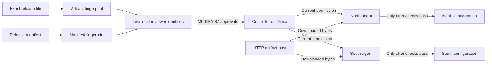
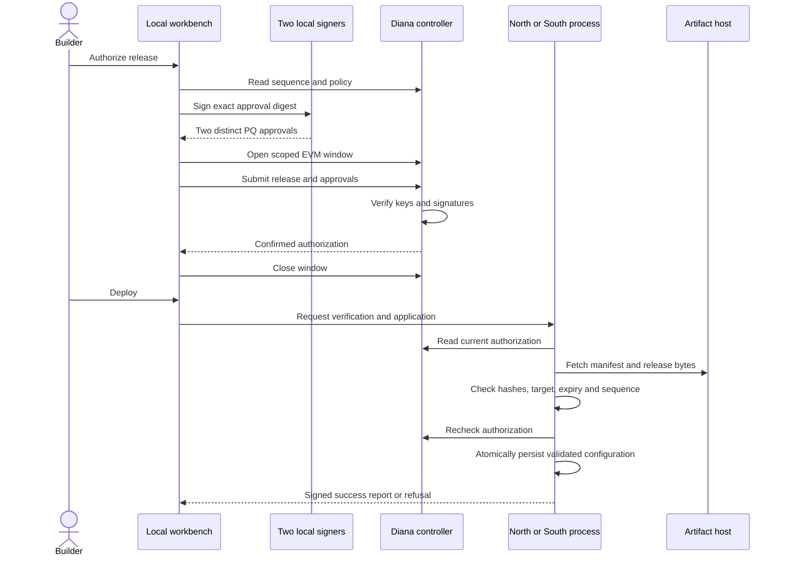

# Veylith

**The release you approved. The bytes they receive.**

**First time here?** Start with [the plain-English explanation](#plain-english-explanation), then follow [the guided demonstration](#guided-demonstration-click-by-click). Developers can jump to [run locally](#run-locally), [architecture](#architecture), or [troubleshooting](#troubleshooting).

Veylith is an exact-release authorization prototype for QoreChain's Build Before Q-Day fest. Two reviewers approve a fingerprint of an artifact and its manifest using ML-DSA-87. A Solidity controller verifies the approvals on Diana. Two independent local deployment-agent processes fetch the hosted bytes, check current chain authorization and apply only the approved configuration.

**Status:** functional testnet/local prototype; unaudited. Category: Post-Quantum dApp. The visuals explain real operations, while the application and reviewer identities are intentionally small demo fixtures.

## What works

- A live two-reviewer controller uses QoreChain `pqcVerify` and `pqcKeyStatus`, requiring registered keys with proof of possession.
- Approvals bind chain, controller, project, environment, artifact, manifest, sequence, expiry and policy epoch. Policy rotation requires the old quorum and invalidates the previous release.
- SDK hybrid native transactions open bounded EVM windows for the deployed target, then explicitly close them.
- Two separate Node processes download a bounded JSON configuration and manifest from the local HTTP artifact host, verify authorization and bytes, persist anti-replay state and apply atomically.
- An interactive React workbench shows actual local application state, agent refusals and public transaction evidence. Agent success reports use Ed25519 signatures; these are not PQ receipts or remote attestation.
- 13 Hardhat contract tests and 10 agent tests pass. The live end-to-end walkthrough passed 9 checks; see [public evidence](evidence/live-flow.json).

## What is still unfinished

QoreX browser-based arbitrary-message PQ signing; authenticated QoreSeal reviewer packets in the application; confirmation of the public hosted deployment; the event-required two-stage QCAI audit; independent review of security claims; final cover/video and project-page completion. The installed QoreSeal package is not evidence of completed app integration. Contract tests use mock precompiles locally; the live proof separately exercises real Diana precompiles.

## Public testnet deployment

Network: `qorechain-diana` (EVM chain ID 9800).

| Item | Identifier |
|---|---|
| Release controller | `0x9700232112bda62e79f20ceb862ed5e6182b9872` |
| Maintainer native address | `qor1p2nf2u4kpp2smxuuruqr959z3eeapmlkncxlkr` |
| Maintainer EVM twin | `0x0Aa69572B608550D9b9C1f0032D0A28e73D0eFF6` |
| Security-reviewer native address | `qor16ym4tg4wq837unfa3rlkwv2u29szduvjwlrnuq` |
| Deploy transaction | `0xf1afd44694f743c2e87db1efcb42fe23c7e4bf292eeaed6eea0b00bcfc5d26e0` |
| Proven release authorization | `0x7135333fce5bb89f066ecd6bd1c3af04bc6f523bb4ec766ff0d6c3ba9cccc434` |
| Proven revocation | `0xe3c6a5bdc92da3b0c20d1c0d35ec6951f850c62a18e543d63af8e9f50020e512` |

The proof ends with the release revoked. Already applied demo configurations remain applied. This is expected behavior, not rollback.

## Run locally

### Vercel public verifier

`vercel.json` builds the Vite frontend and deploys read-only `/api/state` and `/api/proof` functions. The public page queries the current Diana controller; recorded actions and test evidence are dated separately. It does not run reviewer signers or local agent processes. A failed chain read never substitutes the historical chain snapshot as live state.

Import this GitHub repository into Vercel using the Vite preset, or run `npx vercel --prod` after Vercel login. No signing environment variables are needed. `.vercelignore` excludes local runtime/signing material; public API imports have no dependency on `lib/chain.mjs` or the local signer service.

Node.js 24 and npm were used for verification. Install and run the public checks:

```sh
npm ci --ignore-scripts
npm test
npm run build
```

The application runs with:

```sh
npm run dev
```

Open `http://127.0.0.1:5173`. Without local test identities/deployment state, the UI holds deployments and reports that live setup is unavailable. The public repository contains no signing secrets.

### Testnet identities and deployment

For the original workspace, `npm run setup:testnet` reads the already generated disposable account from the neighboring research workspace, prepares a second local demo reviewer, registers both PQ keys, and deploys the controller. It intentionally refuses to overwrite a deployment if its source hash changes.

For a standalone clone, generate two disposable funded Diana identities on your own machine and place only their mnemonic fields in ignored `.local/reviewers.json` as a JSON array of two objects. Run setup after compiling with `npm run test:contracts`; the helper reuses these local identities. Never commit that file. Registration/deployment consumes test QOR only. The local demo server signs on behalf of these two identities when an action is requested; this is a demonstration convenience, not a production custody design.

The server binds to loopback, restricts write requests to same-origin JSON and denies HTTP access to local signing files. Do not expose this signer server through a public tunnel. A public demo needs an independent wallet/signing design.

With the local server running, `npm run proof:testnet` submits testnet authorization and revocation transactions and runs both agents. It overwrites the public walkthrough evidence with the new result. Do not use a pre-drill proof as the transaction required during the actual drill window.

## Architecture

`contracts/ReleaseController.sol` is the authority boundary. `lib/chain.mjs` contains SDK/QoreSign/native-window integration. `agent/core.mjs` implements verification and atomic application. `agent/worker.mjs` runs each independent agent. `server.mjs` hosts demo artifacts, manages the processes and local signer actions. `src/` is the visual workbench. `evidence/` contains public results only.

The test doubles under `contracts/test/` exist solely for Hardhat error-path testing; none is deployed to Diana. The live key-status interface decodes possession proof explicitly because the pinned EVM package's ABI has only three outputs.

## Threat model and limits

The demo assumes a classical publishing/relayer key or artifact host can be compromised while the required PQ reviewer quorum remains uncompromised. Approvals authenticate permission for bytes; they do not prove the software is safe. A compromised reviewer quorum can authorize malicious content. An agent must actually enforce the checks; another pipeline can ignore them. The controlled payload changes a JSON configuration, not a container image or arbitrary program.

Agents check fresh observed chain state and recheck before application. There remains a race between the final chain observation and the local write; this prototype does not provide atomic transactions across a blockchain and filesystem, remote attestation or a formal finality guarantee. A crashed agent may leave a lock requiring operator inspection. Revocation stops future applications observed after revocation; it cannot undo prior deployment or erase previously decrypted data.

The official Q-Day Drill is external testing. Enrollment and survival have not been established by the local proof. The disposable classical key is submitted only through the official drill form; neither mnemonic nor PQ secret belongs there.

## Credits and original work

Built with QoreChain SDK/EVM 0.14.0 and QoreSign 0.2.0, viem, React, Vite, Solidity/solc, Hardhat and ethers. Fonts are locally bundled from Fontsource: DM Sans, Playfair Display and IBM Plex Mono; their upstream font licences are included in the installed packages. QoreSeal 0.1.0 was evaluated separately; app integration remains pending.

Research inspiration: [Sthylé](https://dorahacks.io/build/23836) for artifact lineage and [ShadowPool](https://dorahacks.io/build/38991) for exact request-to-execution binding. No code from those projects was copied. Related QoreChain entries include The Record, QoreWitness, Sealed Disclosure, LatticeWard, Fenestella and Q-Day Readiness Audit. Our intended distinction is the enforced release-to-deployment workflow; worldwide novelty is not claimed.

See [AI_USAGE.md](AI_USAGE.md) for the AI-assisted workflow. Original project source is released under the [MIT licence](LICENSE).

## Plain-English explanation

Imagine approving a parcel, then discovering that its contents were replaced before delivery. The delivery address and label can remain unchanged even though the package is different.

Software has the same problem. Reviewers might approve a release, but an attacker with access to the download server can substitute a different file. A compromised publishing credential should not automatically become permission to deploy those different contents.

Veylith connects approval to delivery: **the file an agent applies must be exactly the file authorized by the reviewers, and that authorization must still be valid.**

### What QoreChain does here

QoreChain is the blockchain our prototype uses as a shared authorization record. Its post-quantum signature verification tools let the contract check ML-DSA-87 approvals. Its key registry lets the contract check that a reviewer's signing key is registered and has proof of possession. Its hybrid transactions and EVM authorization windows protect the transport used to submit actions.

QoreChain does not hold or download our software bundle. It records permission tied to its fingerprint. The deployment agents fetch the file and enforce that permission locally.

### Vocabulary without assumptions

| Term | Meaning in this project |
|---|---|
| Artifact / bundle | The exact file being delivered: a small JSON configuration in this demo. |
| Bytes | The actual contents of that file, including formatting and newline characters. |
| Hash / fingerprint | A value calculated from those bytes. A changed file should produce a different hash. We use Keccak-256. |
| Manifest | A description naming the release version, project, environment and artifact hash. Its exact encoded bytes have a hash too. |
| Reviewer | An identity authorized to approve a release. This demo uses two identities, both operated locally by the solo builder. |
| Signature | Cryptographic evidence that a signing key approved particular bytes. It is not proof that a human carefully inspected them. |
| Post-quantum | Designed to resist known attacks using future quantum computers. It is not a guarantee about every component of an application. |
| Contract / controller | A program on QoreChain that checks approvals and stores the current release permission. |
| Agent | A separate local Node process that fetches, checks and applies the configuration. It is not an AI model. |
| Environment | The intended deployment target, such as production. Approval for one target should not authorize another. |
| Sequence | A counter that advances with accepted controller actions. Agents persist the last sequence they applied to prevent reuse. |
| Policy epoch | The version of the reviewer policy. Changing authority invalidates the old release permission. |
| Revoke | Withdraw permission for future application of a release. It does not uninstall an already applied release. |
| Testnet | A development network using test funds. The application is not deployed on QoreChain mainnet. |

## The system in pictures

GitHub renders the following Mermaid diagrams. They describe the implemented boundaries; decorative gate artwork in the interface is an explanatory metaphor.





## What is real, simulated, and unfinished

| Element | Actual status |
|---|---|
| QoreChain contract | Deployed on the real Diana testnet; public identifiers are above. |
| Review signatures | Real ML-DSA-87 signatures, checked by real Diana precompiles in the live walkthrough. |
| Two reviewers | Two distinct keys, but both are controlled by the local demo operator; not two independent humans. |
| North and South | Two separate Node child processes on one computer, not two remote servers. |
| Artifact download | Actual HTTP download from the local artifact endpoint. |
| Deployment | Actual validated JSON configuration persisted to each agent's local state file. Not Kubernetes or a production binary rollout. |
| Mini applications | React views of the persisted configuration; they are not separately hosted production services. |
| Tampering | A controlled change to the artifact endpoint, triggered by the operator. No real third-party system is attacked. |
| Bronze capsule, rings and paths | SVG illustrations connected to workbench state; no physical cryptographic hardware. |
| Agent success signatures | Real Ed25519 signatures on reports, distinct from reviewer PQ signatures. They do not prove honest execution. |
| Local tests | Contract tests use explicit test precompiles; the live evidence separately tests actual Diana infrastructure. |
| Public verifier | Read-only current-chain view with separately dated recorded test evidence; it has no connected local signers or agents. |
| QoreSeal in the UI | Unfinished; installing a dependency does not mean the feature works. |
| Browser-wallet approval | Unfinished; the local demo signs using local disposable key material. |
| Security audit / official drill survival | Not established by our own passing tests. |

## Guided demonstration: click by click

### Updated 3D visual workbench

The local workbench now uses Three.js for a release package, rotating authorization rings and delivery particles. These are explanatory visualizations; operation labels come from actual server stages rather than a fabricated progress percentage.

On connection, the first local demo reviewer signs an exact proposal for the next sequence. Click **Review & approve as reviewer 2** to open the local signing panel, inspect the target/sequence/fingerprint and approve using the second local identity. This is not a browser-wallet extension prompt. The UI follows signing, contract simulation, scoped-window opening, transaction submission and receipt confirmation. A first signature alone does not mean the release has on-chain authorization.

Use **Download verified release** or **Verify & install again** on the larger Orbit Commerce app previews. Each preview reflects its agent's persisted configuration. The previous-layout comparison, catalog artwork and static storefront copy are illustrative; the downloaded and validated payload remains the bounded JSON configuration. The visuals do not claim a binary installer or container deployment.

Older button names below describe the same operations. **Inspect the release** remains available, and the primary authorization action now opens the explicit reviewer panel before signing.

### Before starting

1. Start the local server with `npm run dev` from the repository root. Keep that terminal running.
2. Open **http://127.0.0.1:5173** on the same computer. Do not use the public Vercel page for these actions.
3. Wait for the Diana connection. A connection error means the app cannot currently verify chain state; it must hold deployments.
4. Click **Refresh chain** if necessary. If the page says **PUBLIC VERIFIER**, you are viewing the hosted read-only version.
5. Check whether **Restore original bytes** is offered. If it is, click it before your first valid deployment.
6. Existing applications may already show `v1.0.0`. Their persistent state survives restarts. This is expected.
7. Do not run `proof:testnet` at the same time as your manual walkthrough: it changes the same controller sequence and agent state.

### Step 1 — inspect the release

Click **Inspect the release**. You should see:

```json
{
  "release": "1.0.0",
  "banner": "The release you approved.",
  "accent": "#91d8ba"
}
```

Read the manifest below it. The manifest names the intended project/environment/version and artifact fingerprint. Close the dialog with its close button or Escape. This viewer is not an encrypted review packet.

Say: “This is the file we want to deploy. Our permission will name its exact fingerprint.”

### Step 2 — authorize a fresh sequence

Click **Authorize release**, or **Authorize next sequence** if the current release is already authorized. Wait for the operation to finish. It involves chain reads, two local signatures, a native window transaction, an EVM authorization transaction and a window-close transaction. Slow testnet/network conditions can extend the wait.

Expected result: **PQ VERIFIED**, an authorization transaction in the evidence sheet, and a sequence higher than the previous one. After the recorded walkthrough's sequence 2 revocation, the next successful authorization should be sequence 3, unless another operator action has occurred.

Say: “Our contract has checked both post-quantum reviewer signatures. It now permits this exact release.”

If the operation errors, refresh current chain state before retrying. A transaction may have confirmed even if a later network request or window-close operation failed. Never infer failure solely from the UI error.

### Step 3 — deploy North

Click **Deploy** under North. If North already has a previous configuration, the button may say **Verify again**. The same button initiates a new agent check.

Expected result: North reports **APPLIED**, with the new sequence and an observed block. Its mini application displays the approved banner. If its previous release was already `1.0.0`, the banner may look unchanged; the changed sequence and new report prove this was a fresh operation.

Say: “North independently downloaded the bytes and checked current permission before applying them.”

### Step 4 — deploy South

Click South's **Deploy** or **Verify again** button. Wait for its own result.

Expected result: South independently reports **APPLIED** for the same new release sequence. It is a second process with a separate persistent state file, not just a second animation.

Say: “South performs its own verification. Both agents accepted the approved release.”

### Step 5 — replace hosted bytes

Click **Replace hosted bytes**. This changes what the local artifact endpoint returns; it does not change the approved fingerprint on-chain.

Click North's **Verify again**. Expected refusal: **Artifact hash mismatch**. The expected and observed fingerprints differ. North's existing applied configuration remains intact. The red lane represents that refusal.

Say: “The download address is the same, but the contents changed. The agent rejects the substituted file.”

### Step 6 — restore the file and demonstrate replay protection

Click **Restore original bytes**. Click North's **Verify again** without authorizing a new sequence.

Expected refusal: **Sequence already applied**. This is a successful protection check. The original bytes are back, but North has already applied this permission.

Say: “Even the correct file cannot reuse a deployment sequence this agent has already applied.”

### Step 7 — revoke authorization

Click **Revoke authorization** and wait for confirmation. Revocation is itself a new PQ-approved controller action and advances the sequence.

Expected result: **REVOKED**. Click South's **Verify again**. Expected refusal: **Release revoked**. South's existing application still shows the previously applied configuration.

Say: “Permission has been withdrawn. Future deployment attempts stop. This does not undo a deployment already applied.”

### Step 8 — inspect and export the proof

Click **Evidence**. Read the network, contract, observed block, approved artifact hash, manifest hash and controller action history. Compare agent outcomes with those actions. Use **Download public evidence** to export the local workbench state.

The local export is a current workbench snapshot. The Vercel export additionally separates current chain state from the committed recorded walkthrough. Historical action lists do not claim to be a complete on-chain event index.

### Step 9 — repeat the demo

Restore original hosted bytes, authorize the next sequence, then deploy again. Keep persistent agent history. You do not need to delete local files or reset the controller. A new sequence makes the next legitimate demonstration possible.

## A three-minute video plan

**For your video, use the local workbench.** The Vercel version was prepared as a public verifier; its signing and deployment controls are disabled. Public deployment itself hasn't been confirmed.

| Approximate time | Screen action | Suggested narration |
|---|---|---|
| 0:00–0:20 | Main screen | “An approved software download can be replaced before deployment. Veylith binds permission to the exact bytes.” |
| 0:20–0:40 | Inspect release and manifest | “This demo configuration has a fingerprint and a named target environment.” |
| 0:40–1:10 | Authorize and inspect the transaction | “Two local demo identities approve it. QoreChain checks their post-quantum signatures.” |
| 1:10–1:40 | Deploy North, then South | “Separate agents fetch the actual bytes, check permission and apply only the approved configuration.” |
| 1:40–2:10 | Replace bytes, verify North | “Changed contents produce a different fingerprint. Deployment is refused.” |
| 2:10–2:35 | Restore, revoke, verify South | “Revocation stops another attempt, while existing deployments remain applied.” |
| 2:35–2:55 | Evidence sheet | “Transactions and agent results make each step inspectable. This is a testnet prototype with local signing and configuration releases.” |

Rehearse before recording. Pause recording during long confirmations if necessary, and disclose time cuts rather than presenting pending transactions as confirmed. Keep signing files, recovery phrases and private keys out of the screen recording. Do not claim browser-wallet support, independent human reviewers, an audit, production rollout or official drill survival.

## Starting, stopping, and recovering

On the original Windows workspace:

```powershell
Set-Location 'C:\Users\DELL\Documents\If at all\veylith'
npm run dev
```

On another machine, clone the public repository and install the lockfile first:

```sh
git clone https://github.com/Goodyness-dev/veylith.git
cd veylith
npm ci --ignore-scripts
npm run test:contracts
```

Then follow the testnet identity setup earlier in this README. A clone contains public source and evidence, not access to the original review keys or control over the existing two-reviewer contract. New identities require their own deployment. Starting the frontend alone cannot grant them authority over our recorded controller.

Stop a manually launched server with **Ctrl+C** in its terminal. Restarting resets the hosted-byte tamper toggle and in-memory report list. It retains the transaction journal, agent applied configurations, reviewer identities and deployment metadata. It does not reset blockchain state.

## Commands and file locations

| Command | Effect |
|---|---|
| `npm run dev` | Starts loopback server, frontend and two agent processes. |
| `npm test` | Runs 13 contract checks, 10 agent checks and three public-verifier checks; does not submit testnet writes. |
| `npm run build` | Builds the frontend into `dist`; does not deploy a contract or start agents. |
| `npm run setup:testnet` | Prepares/reuses local disposable identities, registers keys and deploys/reuses a controller. Uses test funds. |
| `npm run proof:testnet` | Requires local server; executes nine live walkthrough checks, submits transactions and ends revoked. Updates the public evidence file. |
| `node scripts/check-secrets.mjs` | Checks staged files against known local signing secrets and key-file markers. |

| Path | Purpose / publication status |
|---|---|
| `.local/reviewers.json` | Secret local demo identities; ignored, never published. |
| `.local/deployment.json` | Local public deployment metadata used by the signer workbench; ignored as runtime state. |
| `.local/transactions.json` | Persisted local controller action history. |
| `.local/agents/north/applied.json` | North's persistent applied configuration and sequence. |
| `.local/agents/south/applied.json` | South's independent applied configuration and sequence. |
| `.local/agents/*/report-key.pem` | Secret Ed25519 report signing keys; ignored. |
| `evidence/live-flow.json` | Published recorded test evidence, including public identifiers and results. |
| `api/` and `lib/public-state.mjs` | Read-only Vercel handlers; no local wallet loader. |

Do not delete applied-state journals to make a demo appear fresh. That erases replay history and changes the agent's trust assumptions. Demonstrate a new sequence instead.

## Troubleshooting

| Symptom | Meaning and next step |
|---|---|
| Browser cannot open localhost | Start `npm run dev` and leave it running. Confirm the printed port. |
| `EADDRINUSE` | Another process owns the port. Reuse an existing Veylith instance or identify that process before stopping it. |
| Public page has disabled actions | Expected. The Vercel view is read-only; use localhost for signing and deployment. |
| Already shows `v1.0.0` before rehearsal | Persisted prior deployment. Authorize a fresh sequence; inspect the new sequence/report instead of expecting a different banner. |
| `Sequence already applied` | Agent replay protection worked. Authorize a new sequence for another legitimate application. |
| `Artifact hash mismatch` | Hosted bytes differ from approval. Restore original bytes for the valid path. |
| `Manifest hash mismatch` | Downloaded manifest differs from its approved bytes. Stop and inspect the manifest/source; do not bypass the check. |
| `Release revoked` | Current permission is withdrawn. Authorize a new sequence if you intend a new legitimate release. |
| `Approval expired` | Permission's deadline has passed. Generate a fresh authorization; do not change the system clock. |
| `Policy changed` / key mismatch | Current reviewer policy or registry key differs from expectations. Inspect authority state; do not weaken verification. |
| `RPC unavailable`, stale chain, fetch failure | Current state cannot be trusted. Keep the existing deployment, restore connectivity and refresh. Inspect chain state before retrying a write. |
| Timeout after authorization | A write may already have confirmed. Refresh sequence/history before repeating it. |
| Agent busy / applying lock | Let its operation finish. After a crash, inspect the process and applied journal before manually addressing a stale lock. |
| No local reviewers/deployment on a clone | Expected: secrets are excluded. Prepare your own funded disposable identities and controller. |

## Reading the evidence correctly

The original live walkthrough recorded nine passing checks: a confirmed two-reviewer authorization; North apply and report verification; South apply and report verification; substituted-byte refusal; replay refusal; revoked-release refusal; and preservation of existing configurations after revocation.

The 13 Hardhat checks exercise contract error paths with mock precompiles. The 10 agent checks exercise local enforcement, including network failure and revocation during verification. The three public-verifier checks ensure historical agent state is not presented as live and wrong-network/stale/unavailable reads fail closed. A successful frontend build checks packaging, not security.

No invented performance benchmark or winning probability is included. Network latency varies, and a signature proves authorization rather than the correctness or safety of a release. See the threat model above for the remaining limitations.
